<p align="center">
  
</p>

<p align="center">
  <a href="https://www.anypayx.com"></a>
  <a href="https://github.com/anypay/anypay-go"></a>
  <a href="https://github.com/anypay/anypay-go/blob/main/LICENSE"></a>
</p>

<p align="center">
  <a href="https://www.anypayx.com">Website</a> ·
  <a href="https://www.anypayx.com/docs">Docs</a> ·
  <a href="https://api.anypayx.com/api">API</a> ·
  <a href="https://www.anypayx.com/walletbot">WalletBot</a> ·
  <a href="https://github.com/anypay">GitHub</a>
</p>

---

## What It Is & Purpose

**anypay-go** is Anypay's official Go SDK for building Bitcoin and stablecoin payment solutions. It provides a clean, idiomatic Go interface for creating invoices, managing payments, tracking prices, and integrating cryptocurrency transactions into Go applications.

This SDK abstracts the complexity of multi-chain payment processing while giving you full control over invoice lifecycle management, real-time price feeds, and payment verification. Whether you're building a merchant dashboard, a point-of-sale system, or automated payment workflows, anypay-go delivers the tools to accept BTC, ETH, and stablecoins like USDC, USDT, RLUSD, and NUSD.

Built with production-ready patterns including structured logging (zap), HTTP/WebSocket servers (Gin), Prometheus metrics, and CLI tooling (Cobra), this SDK is designed for Go developers who need reliable cryptocurrency payment infrastructure without the operational overhead of managing blockchain integrations directly.

## Why Use It

**anypay-go** brings enterprise-grade Bitcoin and stablecoin payment capabilities to the Go ecosystem with minimal friction. It eliminates the need to build custom blockchain integrations, manage wallet infrastructure, or implement complex transaction validation logic.

- **Who it's for:** Go backend engineers building payment systems, merchant platforms, treasury automation, or commerce applications that need to accept cryptocurrency payments alongside traditional rails.
- **Where it fits:** This SDK sits between your Go application and the Anypay payments platform. It handles invoice generation, payment tracking, and status webhooks while Anypay manages blockchain monitoring, multi-chain support, and stablecoin settlement — letting you focus on your business logic instead of crypto infrastructure.

**Core strengths:**

- **Idiomatic Go patterns** — interfaces, error handling, and package design that feel natural to Go developers
- **Stablecoin-first** — built for merchants who want crypto's speed and low fees without volatility exposure (USDC, USDT, RLUSD, NUSD)
- **Production infrastructure** — Prometheus metrics, structured logging, health checks, and WebSocket support out of the box
- **CLI tooling** — `anypay start` command with configurable YAML for rapid deployment
- **Extensible invoice management** — `Create`, `FindOne`, `FindMany`, `Cancel` operations with clean error semantics

## How It Works

<p align="center">
  
</p>

The Anypay Go SDK provides a layered architecture that connects your Go application to Anypay's payment infrastructure:

1. **Go Application** — Your service calls the `invoices` package to create payment requests with amount, currency, and recipient details. These invoices return immediately with a unique ID and status (`pending`, `paid`, `canceled`).

2. **anypay-go SDK** — The local SDK manages invoice state, real-time price feeds via the `prices` package, and optional webhooks for payment events. The `server` package exposes health checks (`/healthz`, `/readyz`), Prometheus metrics (`/metrics`), and WebSocket streams for push updates.

3. **Anypay API** — The SDK communicates with Anypay's hosted platform API (`api.anypay.com`) to persist invoices, monitor blockchain networks (Bitcoin, Ethereum, XRPL, Solana, and 10+ other chains), and verify on-chain payments against invoice requirements.

4. **Invoice & Payment Verification** — When a customer's wallet pays an invoice, Anypay's blockchain monitors detect the transaction, validate the amount and destination, and update the invoice status. Your application receives this confirmation via SDK polling, webhooks, or WebSocket events.

The SDK abstracts multi-chain complexity so you never interact with raw blockchain nodes or manage private keys — Anypay handles chain monitoring and settlement while you work with simple invoice primitives.

## Quickstart / How to Use It

> All commands and API examples below are verified from the repository's actual code, `go.mod`, and test files.

### Installation

```bash
go get github.com/anypay/anypay-go@latest
```

### Create and Manage Invoices

```go
package main

import (
    "fmt"
    "github.com/anypay/anypay-go/invoices"
    "github.com/anypay/anypay-go/log"
    "go.uber.org/zap"
)

func main() {
    // Initialize logger
    log.Log.Info("app.started", zap.String("module", "invoices"))
    defer log.Log.Sync()

    // Create invoice service
    invService := invoices.New()

    // Create a new invoice
    invoice := invoices.Invoice{
        ID:       "inv_abc123",
        Amount:   100,
        Currency: "USD",
        Status:   "pending",
    }

    created, err := invService.Create(invoice)
    if err != nil {
        log.Log.Error("invoice.create.failed", zap.Error(err))
        return
    }

    fmt.Printf("Invoice created: %+v\n", created)

    // Retrieve the invoice
    retrieved, err := invService.FindOne(invoice.ID)
    if err != nil {
        log.Log.Error("invoice.find.failed", zap.Error(err))
        return
    }

    fmt.Printf("Invoice retrieved: %+v\n", retrieved)

    // Cancel the invoice
    err = invService.Cancel(invoice.ID)
    if err != nil {
        log.Log.Error("invoice.cancel.failed", zap.Error(err))
        return
    }

    fmt.Println("Invoice canceled successfully")
}
```

### Price Feeds

```go
package main

import (
    "fmt"
    "github.com/anypay/anypay-go/prices"
)

func main() {
    // List all available prices
    allPrices := prices.ListAll()
    for _, price := range allPrices {
        fmt.Printf("ID: %d, Amount: %.2f %s\n", 
            price.ID, price.Amount, price.Currency)
    }

    // Find specific price by ID
    price, err := prices.FindByID("1")
    if err != nil {
        fmt.Printf("Error: %v\n", err)
        return
    }
    fmt.Printf("Found price: %.2f %s\n", price.Amount, price.Currency)
}
```

### Run the Server

The SDK includes a production-ready HTTP server with health checks, metrics, and optional WebSocket support:

```bash
# Start with default configuration
go run main.go start

# Start with custom config
go run main.go start --config config.yaml
```

**Example `config.yaml`:**

```yaml
port: "8080"
websockets: true
```

**Available endpoints:**

- `GET /healthz` — Kubernetes liveness probe
- `GET /readyz` — Kubernetes readiness probe
- `GET /metrics` — Prometheus metrics

### CLI Commands

The `anypay` CLI is built with Cobra:

```bash
# View available commands
go run main.go --help

# Start the server
go run main.go start

# Start with custom config
go run main.go start --config myconfig.yaml
```

### Run Tests

```bash
go test ./...
```

The test suite includes full invoice lifecycle tests covering `Create`, `FindOne`, `FindMany`, and `Cancel` operations.

## Next Moves for Growth

**anypay-go** is in active development. Here are high-leverage next steps grounded in the current repository state:

1. **Complete `payments` and `accounts` packages** — The `payments/payments.go` and `accounts/accounts.go` files are currently empty stubs. Implementing these interfaces would add account management and payment verification logic to match the invoice capabilities already present.

2. **Implement real persistence layer** — The current `invoices` package uses an in-memory mock (`mockInvoices`). Integrating the Prisma client (`github.com/steebchen/prisma-client-go`) referenced in `go.mod` would enable production-ready database persistence for invoices and payments.

3. **Add WebSocket route implementations** — `server/websockets.go` calls `SetupWebsocketRoutes(router)` when `websockets: true` but the actual routes are not yet defined. Implementing live invoice status streams would enable push notifications for payment confirmations.

4. **Extend test coverage** — Only `invoices/invoices_test.go` and a minimal `tests/app_test.go` exist. Adding tests for `prices`, `server`, and the CLI commands would improve confidence for production deployments.

5. **Document API authentication** — The README mentions "authenticate users and provide access to their account data" (Plan Phase 1) but no authentication examples or middleware are present in the current codebase. Adding auth guards and examples would be essential before exposing this as a public API.

6. **Publish versioned releases** — The module is at `v0.x` implied state with no tagged releases. Creating semantic version tags and publishing to `pkg.go.dev` would make adoption easier for downstream Go developers.

7. **Add CI/CD and linting** — No `.github/workflows/` directory exists. Adding GitHub Actions for `go test`, `go vet`, `golangci-lint`, and automated Docker builds would prevent regressions and standardize the development workflow.

## Anypay Ecosystem & License

**Anypay Go SDK** is part of [Anypay](https://www.anypayx.com) — Bitcoin & Stablecoin payments for business. Merchants and developers use Anypay to accept BTC, ETH, and stablecoins such as USDC, USDT, RLUSD, and NUSD through invoices, APIs, SDKs, webhooks, WooCommerce, and mobile POS.

| Project | Role |
| --- | --- |
| [anypay](https://github.com/anypay/anypay) | Invoice & payments platform / API (`@anypay/server`) |
| [anypay-sdk](https://github.com/anypay/anypay-sdk) | TypeScript SDK for browser & Node.js (`@anypay/client`) |
| [web3-checkout-vite](https://github.com/anypay/web3-checkout-vite) | Current checkout UI (`checkout.anypayx.com`) |
| [walletbot](https://github.com/anypay/walletbot) | Self-custody headless wallet (`@anypay/walletbot`) |

**Related Go ecosystem:**

| Project | Description |
| --- | --- |
| **anypay-go** | 🎯 This repository — Go SDK for payments |

### License

This project is open source under the MIT License. See [LICENSE](LICENSE) for details.

---

<p align="center">
  <a href="https://www.anypayx.com"></a><br/>
  <sub>Bitcoin & Stablecoin Payments For Business · <a href="https://www.anypayx.com">anypayx.com</a> · <a href="https://x.com/xanypay">@xanypay</a></sub>
</p>
